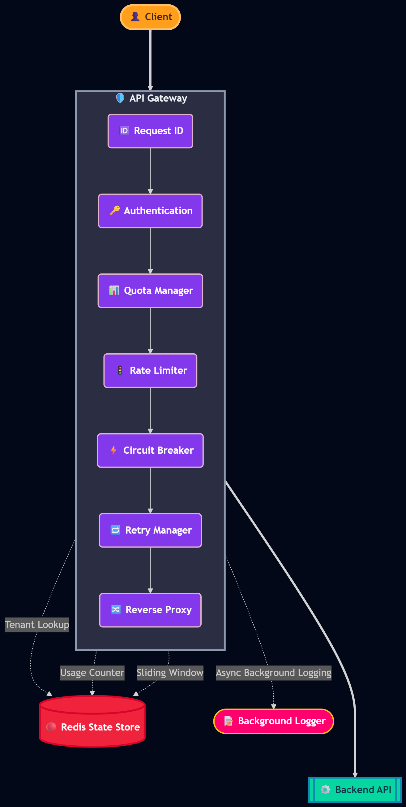
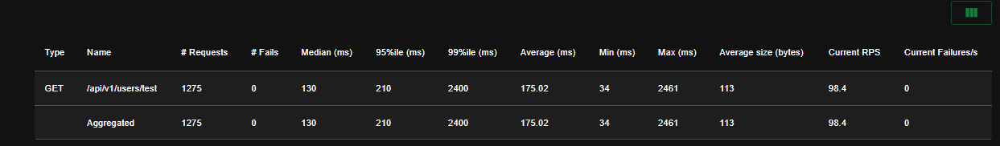
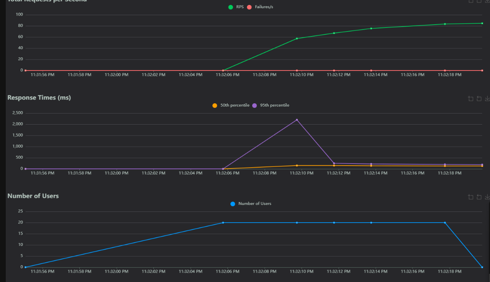
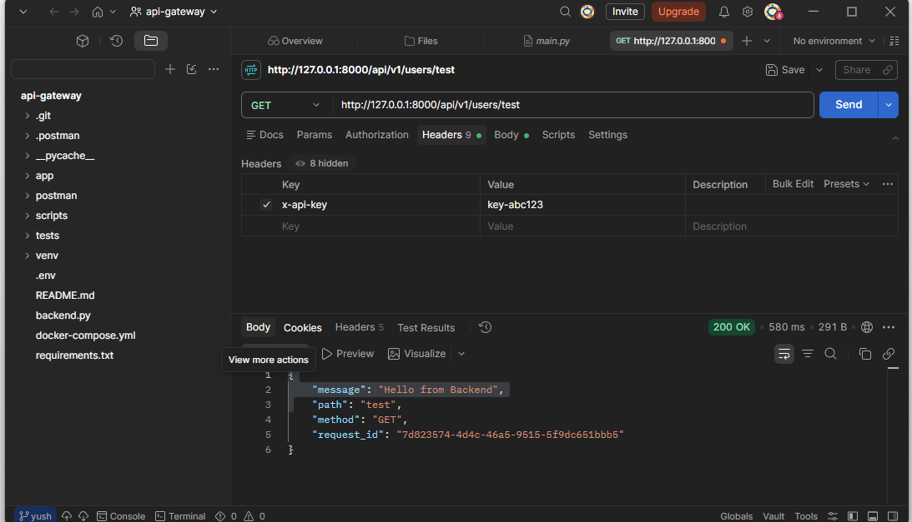
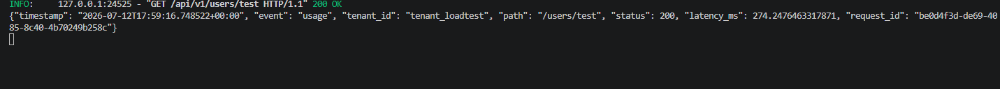
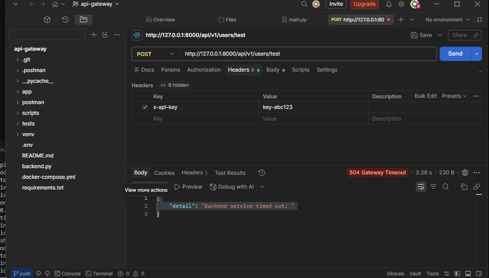
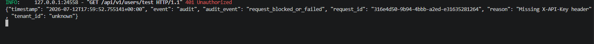

# 🛡️ Multi-Tenant Distributed API Gateway


An async, production-style API Gateway built with **FastAPI**, **Redis**, and **HTTPX** — providing centralized authentication, per-tenant rate limiting/quotas, request tracing, resilient reverse-proxying, and structured observability at the edge of a microservices architecture.

Each core capability (authentication, quotas, rate limiting, retries, circuit breaking, tracing, and logging) was implemented manually to understand how modern API gateways work internally.

---

## 🤔 Why This Project?

Modern backend systems rarely expose services directly to clients. An API Gateway centralizes authentication, request routing, traffic policies, resiliency, and observability before requests ever reach downstream services.

This project explores how those mechanisms — the same ones found in tools like Kong, Envoy, or Traefik — can be implemented manually using FastAPI, Redis, and HTTPX, in order to understand what's actually happening underneath a production gateway.

---

## ✨ Features

| Feature | Description |
|---|---|
| 🔑 **API Key Authentication** | Resolves `X-API-Key` to a tenant profile via Redis |
| 🏢 **Multi-Tenancy** | Tenant metadata (plan, quota, limits) isolated in Redis Hashes |
| 📊 **Quota Management** | Atomic check-and-reserve monthly usage (Lua), refunds non-billable requests, returns `403` on breach |
| 🚦 **Rate Limiting** | Sliding-window limiter in Redis, returns `429` on burst traffic |
| 🔄 **Reverse Proxy** | Async reverse proxy via HTTPX with configurable connect/read timeouts |
| 🔁 **Idempotent Retries** | Exponential backoff, restricted to safe methods (GET/HEAD/OPTIONS) |
| ⚡ **Circuit Breaker** | Closed → Open → Half-Open state machine to fail fast on downstream outages |
| 🔍 **Distributed Tracing** | `X-Request-ID` generated/propagated across all logs |
| 🧾 **Structured Logging** | Async, zero-latency usage + security audit logs via `BackgroundTasks` |
| 📈 **Metrics** | Prometheus text endpoint with counters, uptime, and breaker state |

---

## 🏗️ Architecture

```
Client
  │
  ▼
[Request ID Middleware] → generates/propagates X-Request-ID
  │
  ▼
[Auth Layer] → API Key → Tenant lookup (Redis)
  │
  ▼
[Rate Limiter] → sliding window (Redis, rejected requests are not counted)
  │
  ▼
[Quota Check] → monthly usage (Redis Lua, reserve + refund)
  │
  ▼
[Circuit Breaker] → fail fast if downstream is OPEN
  │
  ▼
[Reverse Proxy] → HTTPX forward with timeouts + retries
  │
  ▼
[Background Tasks] → usage analytics + audit logging
  │
  ▼
Response (200 / 401 / 403 / 404 / 413 / 429 / 500 / 502 / 503 / 504)
```

---

## 🧰 Tech Stack

- **FastAPI** — async web framework
- **HTTPX** — async HTTP client for proxying
- **Redis** — atomic, low-latency state store for tenants, quotas, rate limits
- **Uvicorn** — ASGI server
- **Locust** — load testing

---

## 📁 Project Structure

```
api-gateway/
├── app/
│   ├── main.py                     # App entrypoint & route wiring
│   ├── auth/
│   │   └── tenant_auth.py          # API key → tenant resolution
│   ├── core/
│   │   ├── redis_client.py         # Redis connection
│   │   ├── quota.py                # Monthly quota enforcement
│   │   ├── rate_limiter.py         # Sliding-window rate limiting
│   │   ├── circuit_breaker.py      # Breaker state machine
│   │   ├── logger.py               # Structured JSON logger
│   │   ├── metrics.py              # Prometheus counters + breaker gauges
│   │   └── background_logging.py  # Usage + audit log tasks
│   ├── middleware/
│   │   └── request_id.py           # X-Request-ID injection
│   ├── proxy/
│   │   ├── forwarder.py            # HTTPX reverse proxy + timeouts
│   │   └── retry.py                # Retry + backoff + breaker integration
│   └── config.py                   # Environment-driven settings
├── scripts/
│   ├── seed_tenants.py             # Development tenant seeding
│   └── seed_loadtest.py            # High-limit tenant for Locust
├── tests/
│   ├── conftest.py                 # Fake Redis + breaker fixtures
│   ├── locustfile.py               # Load testing
│   └── test_gateway.py             # Unit/integration tests
├── .env.example
├── .github/workflows/ci.yml       # Test CI
├── .gitignore
├── Dockerfile
├── .dockerignore
├── requirements.txt
├── requirements-dev.txt
├── docker-compose.yml
├── LICENSE
└── README.md
```

---

## 🚀 Getting Started

### Prerequisites
- Python 3.10+
- Redis (local or Docker)

### Installation

```bash
git clone https://github.com/<your-username>/api-gateway.git
cd api-gateway

python -m venv venv
source venv/bin/activate      # Windows: venv\Scripts\activate

pip install -r requirements.txt

# For tests and load testing:
pip install -r requirements-dev.txt
```

### Run Redis

```bash
docker compose up -d redis
```

### Seed Tenant Data

```bash
python -m scripts.seed_tenants
# or: python scripts/seed_tenants.py
```

### Configuration

All settings are environment-driven and use the `GATEWAY_` prefix. Copy
`.env.example` to `.env` and adjust:

| Variable | Default | Purpose |
|---|---|---|
| `GATEWAY_REDIS_URL` | `redis://localhost:6379/0` | Redis connection |
| `GATEWAY_BACKENDS` | `{"users":"http://localhost:9001","orders":"http://localhost:9002"}` | Service routing table |
| `GATEWAY_PROXY_TOTAL_TIMEOUT` | `10.0` | Hard deadline per client request, including retries |
| `GATEWAY_MAX_REQUEST_BODY_BYTES` | `10485760` | Maximum buffered request body (10 MiB) |
| `GATEWAY_RETRY_MAX_ATTEMPTS` | `2` | Retries for idempotent methods |
| `GATEWAY_BREAKER_FAILURE_THRESHOLD` | `5` | Failures before the circuit opens |
| `GATEWAY_BREAKER_RECOVERY_TIMEOUT` | `30.0` | Seconds before a half-open probe |
| `GATEWAY_CORS_ORIGINS` | `[]` | JSON array; empty disables CORS |

### Run the Gateway

```bash
uvicorn app.main:app --reload --port 8000
```

### Run demo downstream services

The gateway routes `users` to port `9001` and `orders` to `9002` by default.
Start the bundled demo backend twice:

```bash
uvicorn app.backend:app --port 9001
uvicorn app.backend:app --port 9002
```

### Run everything with Docker

```bash
docker compose up -d --build
docker compose exec gateway python -m scripts.seed_tenants
```

The compose file points `host.docker.internal` at the host, so run the demo
backends on the host as shown above (or override `GATEWAY_BACKENDS`).

### Test a Request

```bash
curl -i http://localhost:8000/api/v1/users/test \
  -H "X-API-Key: key-abc123"
```

### Run the tests

```bash
pytest
ruff check app tests scripts
```

---

## 🖼️ Screenshots

### 🏗️ Architecture



---

### 📈 Locust Load Test

**Statistics**



**Performance Charts**



---

### ✅ Successful Request



**Structured Usage Log**



---

### ❌ Unauthorized Request



**Structured Audit Log**



## ⚡ Performance

*Measured locally on a single developer machine, single gateway process, local backend.*

| Metric | Result |
|---|---|
| Load test tool | Locust, 20 concurrent users |
| Total requests | 1,275 |
| Failures | 0 |
| Median latency | 130 ms |
| 95th percentile | 210 ms |
| 99th percentile | 2,400 ms |
| Average latency | 175 ms |
| Sustained throughput | ~98 RPS |
| Request tracing | Consistent `X-Request-ID` across gateway + backend logs |
| Background logging overhead | Negligible (async, non-blocking) |
| Circuit breaker | Verified Closed → Open → Half-Open → Closed cycle under induced backend failure |

> Note: an earlier run under a misconfigured test (invalid API key on all requests) showed a ~96% failure rate — this was a test-setup issue, not a gateway fault, and is a good example of the gateway correctly rejecting unauthenticated load rather than passing it through.

---

## 🧪 Testing

```bash
pytest
```

The suite uses `fakeredis` (with Lua support via `lupa`) and covers:

- rejected requests do not grow the rate-limit window
- quota reservations are capped and refunded for non-billable responses
- HALF_OPEN allows only one probe
- backend 5xx responses open the circuit
- 502/504 retries are limited to idempotent methods
- the gateway strips `X-API-Key` before proxying
- compressed response bodies are decoded without leaving `Content-Encoding`
- unknown services are rejected before consuming rate limit/quota
- auth failures return `401`
- `X-Request-ID` is validated and echoed

---

## 📈 Observability

- `GET /health` — liveness probe
- `GET /ready` — readiness probe (pings Redis)
- `GET /metrics` — Prometheus text exposition with request, failure, rate-limit, quota, retry, circuit-breaker, and uptime metrics

All request logs are JSON lines containing `request_id`, `tenant_id`, `method`, `path`, and `status_code` where available.

---

## 🧪 Load Testing

```bash
locust -f tests/locustfile.py --host=http://localhost:8000
```

Open `http://localhost:8089` to configure concurrent users and monitor latency, error rates, and circuit breaker behavior under load.

---

## 📡 API Behavior Reference

| Scenario | Response |
|---|---|
| Missing/invalid API key | `401 Unauthorized` |
| Monthly quota exceeded | `403 Forbidden` |
| Rate limit exceeded | `429 Too Many Requests` |
| Unknown service | `404 Not Found` |
| Downstream circuit open | `503 Service Unavailable` |
| Redis unavailable | `503 Service Unavailable` |
| Backend connection failure | `502 Bad Gateway` |
| Downstream timeout after retries | `504 Gateway Timeout` |
| Request body too large | `413 Payload Too Large` |
| Successful proxy | `200 OK` (+ backend response) |

Every response includes an `X-Request-ID` header. Successful responses also
include `X-RateLimit-*` and (when billable) `X-Quota-*` headers; `429`/`503`
responses include `Retry-After` where applicable.

---

## ⚠️ Known Limitations & Future Work

- **Redis is a single point of failure** for tenant lookup, quotas, and rate limiting. Failures currently fail closed with `503`; a configurable fail-open mode is not implemented.
- **Circuit breaker state is in-memory per process** — running multiple gateway instances requires moving this into Redis, or explicitly accepting independent per-instance tripping.
- **Request bodies are buffered in memory** up to `GATEWAY_MAX_REQUEST_BODY_BYTES` (10 MiB by default); responses are streamed back to the client. Streaming request uploads is future work.
- **API key auth has no rotation, hashing, or revocation** — keys are stored in plaintext Redis keys.
- **Tenant onboarding is manual** via `scripts/seed_tenants.py` — no admin API yet.
- **No Redis Cluster/Sentinel** — sufficient for local/single-instance use, not for horizontal scaling.
- **Metrics are in-process counters** — they reset on restart and are not aggregated across gateway instances.

---

## 📄 License

This project is licensed under the MIT License — see the [LICENSE](LICENSE) file for details.

---

## 🏷️ Topics

`api-gateway` `fastapi` `redis` `python` `microservices` `reverse-proxy` `distributed-systems` `backend` `rate-limiter` `circuit-breaker` `httpx`

---

## 🙋 Author

Built by [Your Name] to explore the core building blocks of modern API Gateways — authentication, multi-tenancy, traffic management, resiliency, and observability — using FastAPI, Redis, and HTTPX.
